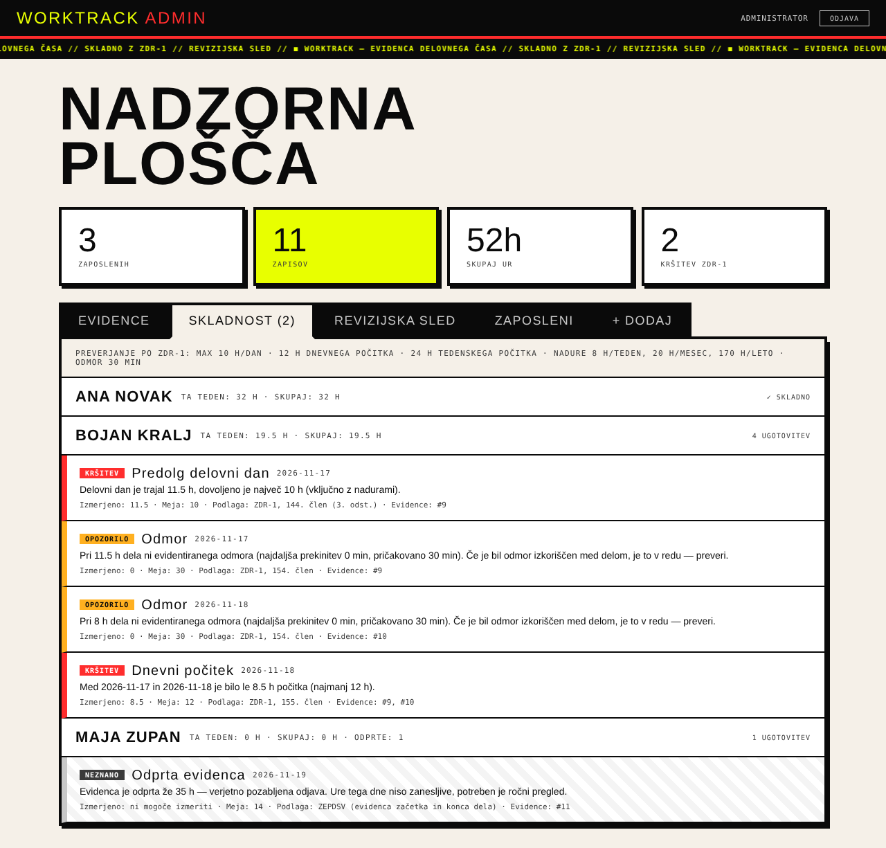
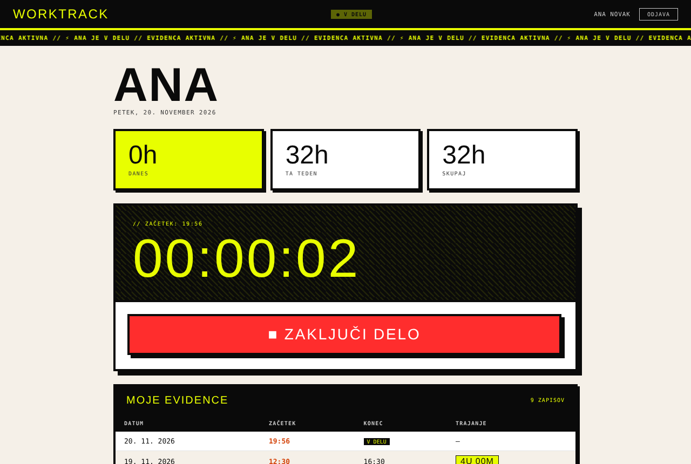
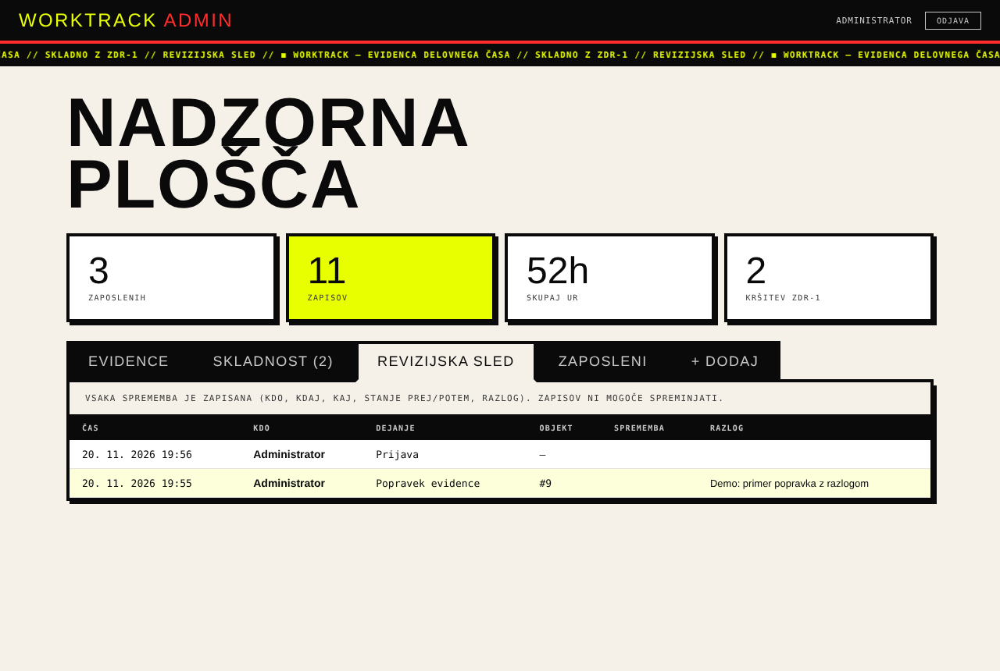

# WorkTrack

**Working-time tracking for Slovenian companies that checks every record against the Employment Relationships Act (ZDR-1) and keeps a tamper-evident audit trail.**

Employees clock in/out with one button. Admins see every record, fix mistakes (always with a reason), export CSV, and get an automatic compliance report: who worked too long, who did not get the legally required rest, how much overtime is left this month.



| Employee | Audit trail |
|---|---|
|  |  |

## Why it exists

Slovenian employers must keep a daily record of start and end of work, breaks, rest periods and overtime for every employee (ZEPDSV), and the limits in ZDR-1 are strict. Most small companies track hours in Excel, where nobody notices a 12-hour day or a 7-hour gap between shifts until the labour inspector does. WorkTrack makes those problems visible the day they happen.

## Compliance engine

`server/src/compliance.ts` is a **pure, deterministic function**: `checkCompliance(sessions, now, config) → Finding[]`. No database, no clock, no hidden state — so it is fully unit-tested and every result can be reproduced.

Each finding is explainable on its own: rule, legal basis, measured value, limit, period, and the IDs of the exact records it was derived from.

| Rule | Limit | Legal basis | Severity |
|---|---|---|---|
| Length of working day | max 10 h incl. overtime | ZDR-1, Art. 144(3) | violation |
| Daily rest | min 12 h between working days | ZDR-1, Art. 155 | violation |
| Weekly rest | min 24 h uninterrupted in 7 days | ZDR-1, Art. 156 | violation |
| Weekly overtime | max 8 h above contract hours | ZDR-1, Art. 144(3) | violation |
| Monthly overtime | max 20 h | ZDR-1, Art. 144(3) | violation |
| Yearly overtime | 170 h (230 h with written consent) | ZDR-1, Art. 144(3) | warning / violation |
| Break | 30 min when working ≥ 6 h | ZDR-1, Art. 154 | warning |
| Forgotten clock-out | open record older than 14 h | ZEPDSV | **unknown** |

**"Unknown" is a first-class state.** A record without an end time is never silently counted as 0 h or as "still working". It is excluded from totals, flagged for manual review, and any other finding on that day is marked as incomplete.

Documented simplifications: a record belongs to the day it started (Europe/Ljubljana); overtime = hours above the employee's contract hours in the ISO week; a break is detected as a gap ≥ 30 min between records.

## Audit trail

Every change goes through `audit()` inside the same database transaction as the change itself, so they succeed or fail together.

- `audit_log` is **append-only**: the application never updates or deletes it.
- Each entry stores who, when, what, the full row **before and after**, and a **reason**.
- Admin edits, manual entries and deletions are rejected without a reason (min 5 characters).
- Failed logins are recorded too.

## Tests

```
npm test
```

- **Compliance rules** (`server/test/compliance.test.ts`): boundary values (exactly 10 h is allowed, 10 h 1 min is not), rest across midnight, contract hours, unknown state, order-independence.
- **API** (`server/test/api.test.ts`) against an in-memory PostgreSQL (pg-mem): hashed passwords, role checks, the start/stop state machine (double start → 409), edits require a reason, before/after values are stored in the audit trail, and the compliance report flags a long day end-to-end.
- **Client** (`client/src/format.test.ts`): CSV export (BOM, `;` separator, decimal comma for Slovenian Excel).

CI runs typecheck, tests and build on every push.

## Stack

- **Server:** Node.js, Express 5, TypeScript, PostgreSQL (`pg`), Zod validation, JWT, bcrypt
- **Client:** React 19, TypeScript, Vite
- **Tests:** Vitest, Supertest, pg-mem
- **Deploy:** Render (API) + Neon (Postgres) + Vercel (client) — see `render.yaml`

## Run locally

Quickest — no database needed (in-memory demo data):

```bash
npm install
npm run demo -w server     # API on :3001
npm run dev -w client      # UI on :5173
```

With real PostgreSQL:

```bash
npm run db:up              # docker compose: Postgres + schema + seed
cp server/.env.example server/.env
npm run dev
```

Demo logins: `ana.novak@podjetje.si / test123`, `admin@podjetje.si / admin123`

## Project structure

```
db/            schema.sql (users, time_records, audit_log), seed.sql
server/src/    app.ts, compliance.ts, audit.ts, routes/, middleware/
server/test/   compliance + API tests
client/src/    views/ (Login, Employee, Admin), components/, api.ts, format.ts
```

---

Built by [David Marković](https://github.com/davidmarkovic952-dev).
